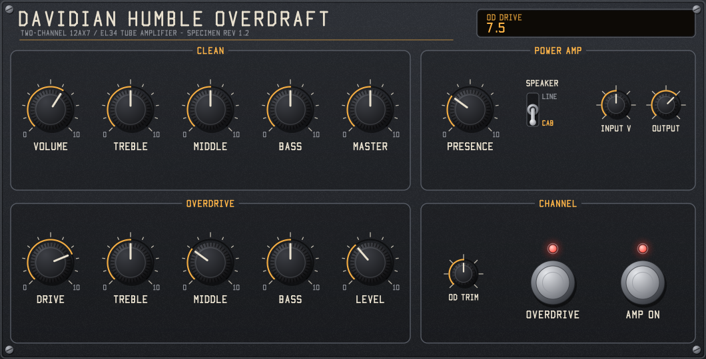

# Davidian Humble Overdraft

A circuit-modelled LV2 guitar amplifier, built from the schematic titled **"1997 Humble Overdraft Specimen, Revision 1.2"**: a two-channel tube amp with four 12AX7 preamp stages, separate clean and overdrive tone stacks, a long-tailed-pair phase inverter and two EL34s in push-pull, with presence and negative feedback.



Mono in, mono out, with a Windows GUI. The code also has a Linux (X11) GUI layer and a CMake build for Linux and macOS, but those have not been built or tested yet. GPL-3.0-or-later.

## Controls

| Panel | Control | Circuit part |
|---|---|---|
| Clean | Volume, Treble, Middle, Bass, Master | 1MA volume, 250kB treble, 250kA middle, 500kA bass, 1MA clean master |
| Overdrive | Drive, Treble, Middle, Bass, Level | 250kA drive, 250kB treble, 20kB middle, 1MB bass, 1MA OD level |
| Power amp | Presence | 2kB in the feedback network |
| Power amp | Speaker: Line / Cab | Line is the speaker terminal. Cab adds a generic 12" cabinet curve, which is not part of the schematic. |
| Power amp | Input V, Output | Volts at the input jack for a 0 dBFS sample; output level |
| Channel | OD Trim | The internal 100kB trim between the clean section and the overdrive stages |
| Channel | Overdrive footswitch | The channel relay |
| Channel | Amp On footswitch | Plugin bypass, delayed to match the latency |

As in the schematic, the overdrive channel follows the clean channel: the signal goes through V1B, the clean tone stack, Volume and V1A before the relay sends it to the overdrive stages. Clean Volume and the clean tone controls therefore shape the overdrive sound too. The relay takes Clean Master out of the path and puts OD Level in its place.

Knobs read 0 to 10 and map to pot rotation with the tapers on the schematic (A = audio, B = linear). Drag up or down, hold Shift to fine-tune, use the mouse wheel, and double-click to reset.

## How it is modelled

- **Tube stages** (`src/amp.h`, `src/tube.h`): each 12AX7 stage is solved sample by sample with Norman Koren's triode model, with its bypassed cathode resistor and grid current into the source resistance ahead of it. The phase inverter is solved as a coupled pair. The EL34s use Koren's pentode model in push-pull with the screen resistors, grid-current blocking in the 0.1uF coupling capacitors, and supply sag.
- **Passive networks** (`src/network.h`): every tone stack, pot and coupling network between the tubes is entered as a netlist with the schematic's values and solved exactly by nodal analysis, with trapezoidal capacitors and the tube's plate as the source. Each network is reduced to a small state-space system whenever a pot moves.
- **Oversampling** (`src/oversample.h`): 4x at 44.1/48 kHz, 2x at 88.2/96 kHz, none above. The latency is 32 samples (0 when not oversampling), and the plugin reports it to the host.

### Checked against the schematic

`test_dsp` compares the model's quiescent voltages with the ones marked on the schematic:

| Stage | Plate, model / schematic | Cathode, model / schematic |
|---|---|---|
| V1B | 216 / 210 V | 1.61 / 1.72 V |
| V1A | 241 / 242 V* | 1.80 / 1.79 V |
| V2B (first overdrive stage) | 245 / 228 V | 1.74 / 2.03 V |
| V2B (second overdrive stage) | 254 / 229 V | 1.61 / 2.03 V |
| V3 phase inverter | 332, 323 / 303, 317 V | 53 / 61 V |

\* The schematic marks 206 V on V1A's plate, but its own 1.788 V across 3k3 through 150k from 323 V puts the plate at 242 V, so the test uses 242 V.

The Koren 12AX7A fit draws about 15% less current than the tubes measured for the schematic, which is within the normal spread of 12AX7s.

### Estimates (not on the schematic)

- Output transformer: 3.4k plate to plate into 8 ohms, low-frequency roll-off at 20 Hz, high-frequency roll-off at 16 kHz.
- EL34 idle current 35 mA per tube (bias -37.7 V in the model), supply sag resistance 120 ohms.
- Grid input capacitance 100 pF per 12AX7 stage (Miller effect), and grid-current curves for the 12AX7 and EL34.
- The schematic's legend marks blue values as "probable" rather than confirmed: the phase inverter's coupling capacitors (.01uF, .1uF, 0.1uF), 1M grid leaks, 24k tail, 820R, the 200k bias feeds and the bias supply. Some parts are drawn in purple, which the legend does not explain: the 4k7 feedback resistor, the 5k1 grid stoppers, the 33k slope resistor, the 100k resistor and the OD Trim. The model uses all of them as drawn.

## Build

### Windows

Needs Visual Studio with the C compiler (2026, version 18, is the default in `build.bat`; edit `VCVARS` there for another version).

```bash
build.bat
```

This creates `build\humble_overdraft.lv2`. Copy that folder to `%APPDATA%\LV2` or `%COMMONPROGRAMFILES%\LV2`.

### CMake (any platform)

```bash
cmake -B build-cmake -DCMAKE_BUILD_TYPE=Release
```

```bash
cmake --build build-cmake
```

## Tests

After `build.bat`:

```bash
build-test\test_dsp.exe
```

```bash
build-test\ui_render.exe docs\panel.bmp
```

```bash
build-test\lilv_check.exe build
```

`test_dsp` checks operating points, every passive network against an independent frequency-domain solution (agreement within 0.03 dB), the direction of every tone control, distortion against drive, presence, bypass latency, silence, all sample rates and CPU cost (about 19% of one core at 48 kHz on the development machine). `lilv_check` loads the bundle with the LV2 parser from Ardour 9, validates it and runs it.

## Licence

GPL-3.0-or-later. See [LICENSE](LICENSE), [NOTICE.md](NOTICE.md) and [AI_USAGE.md](AI_USAGE.md). Made with generative AI (Claude Code).
